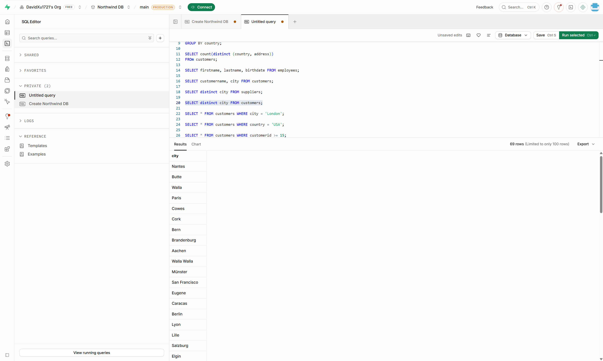
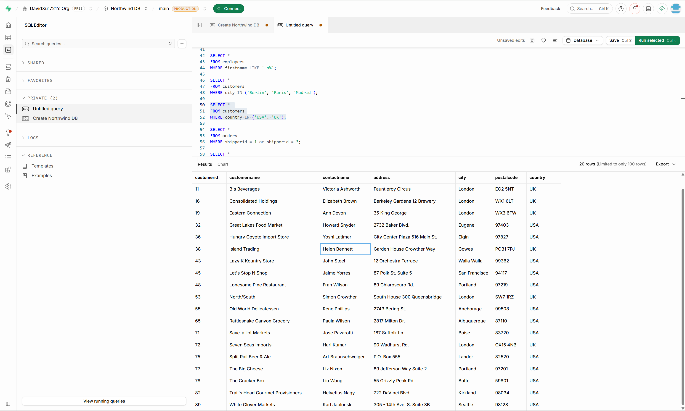
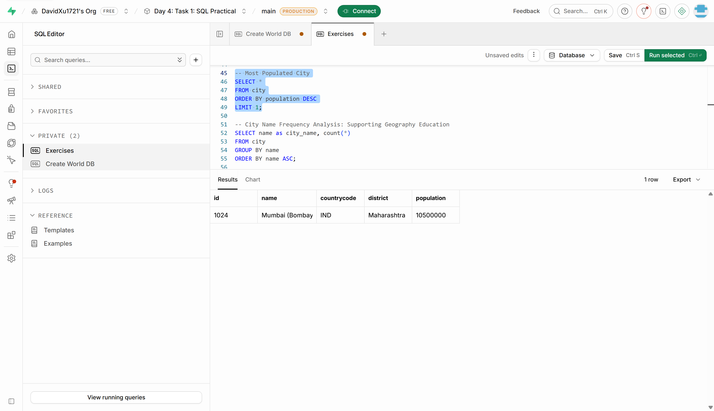
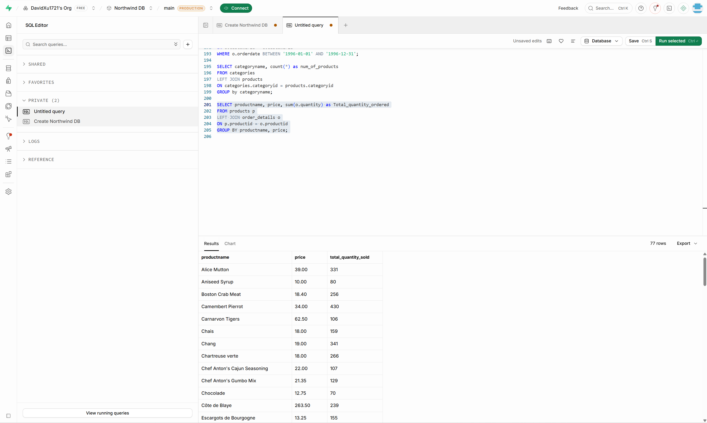
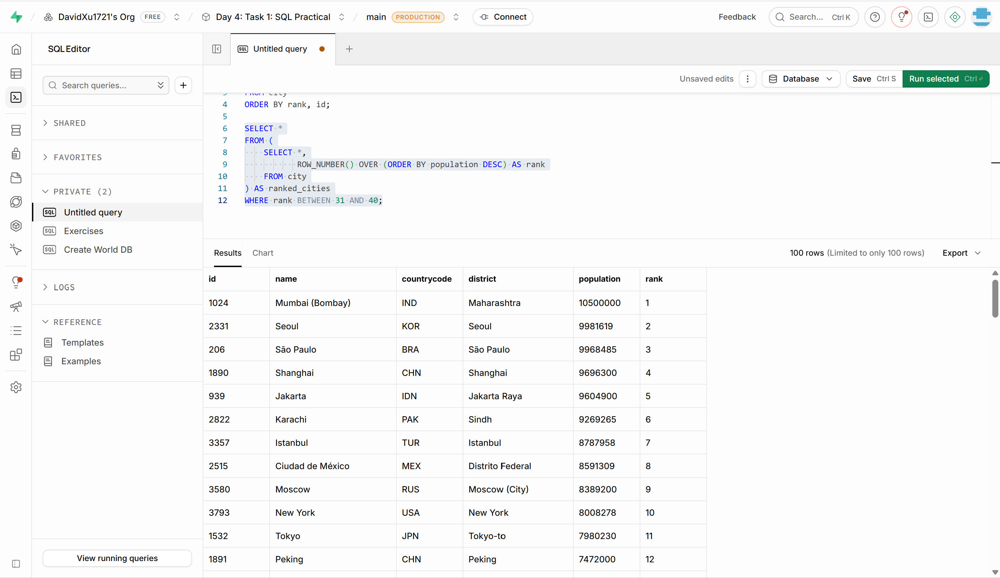

# SQL Data Analysis | Data Technician Bootcamp

## Project Overview

This project was completed during Week 3 of the **Data Technician Bootcamp**, focusing on using SQL to retrieve, filter, and analyse data stored in relational databases.

Using **Supabase (PostgreSQL)** and datasets including the **Northwind retail database** and **World Database**, I developed practical SQL skills to explore customer information, product pricing, orders, sales-related records, and geographical data.

The project focused on extracting meaningful information from structured datasets and applying SQL queries to answer business and analytical questions.

## Skills Demonstrated

- **SELECT & DISTINCT:** Retrieved specific columns and identified unique values from database tables.

- **WHERE:** Filtered records using conditions and operators including `AND`, `OR`, `IN`, `BETWEEN`, and `LIKE`.

- **ORDER BY & LIMIT:** Sorted query results and identified highest- and lowest-value records.

- **GROUP BY:** Grouped records to summarise information and identify patterns across categories.
- **Aggregate Functions:** Used `COUNT()`, `SUM()`, `AVG()`, `MIN()`, and `MAX()` to calculate summary statistics.

- **SQL JOINs:** Combined related tables using `INNER JOIN` to retrieve information across relational datasets.
- **Subqueries:** Used nested queries to filter records based on results from other queries.
- **Relational Databases:** Explored table relationships, primary keys, foreign keys, and database structures.

## Data Analysis Applications

Using SQL, I practised:

- Exploring customer demographics and geographical distribution.
- Filtering products by price and identifying high- and low-priced items.
- Retrieving customer and order information for retail analysis.
- Using aggregate functions to summarise product and sales-related data.
- Combining information from multiple tables to support more detailed analysis.
- Analysing population statistics, geographical patterns, and country-level information using the World Database.

## Tools & Technologies

- **SQL**
- **PostgreSQL**
- **Supabase**
- **Northwind Database**
- **World Database**

## Key Takeaways

This project strengthened my understanding of relational databases and demonstrated how SQL can be used to transform raw data into useful information.

I gained hands-on experience writing queries, filtering and aggregating records, and joining related datasets to investigate business questions.

These skills provide a foundation for further development in **data analysis, business intelligence, reporting, and data-driven decision-making**.
